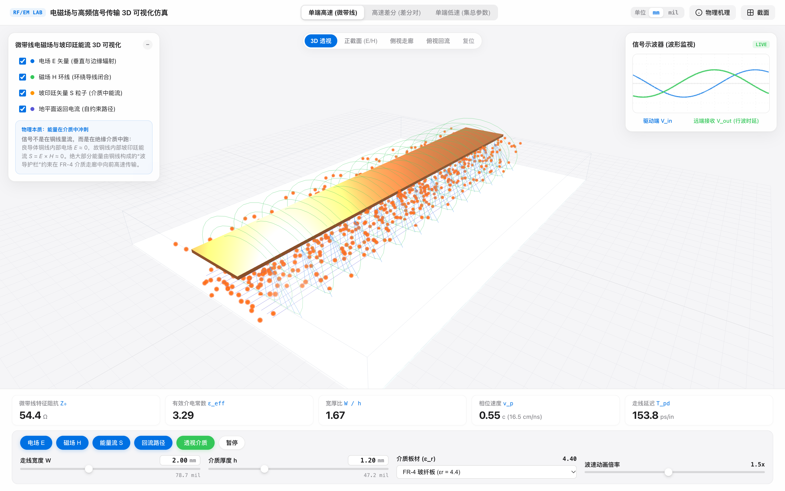
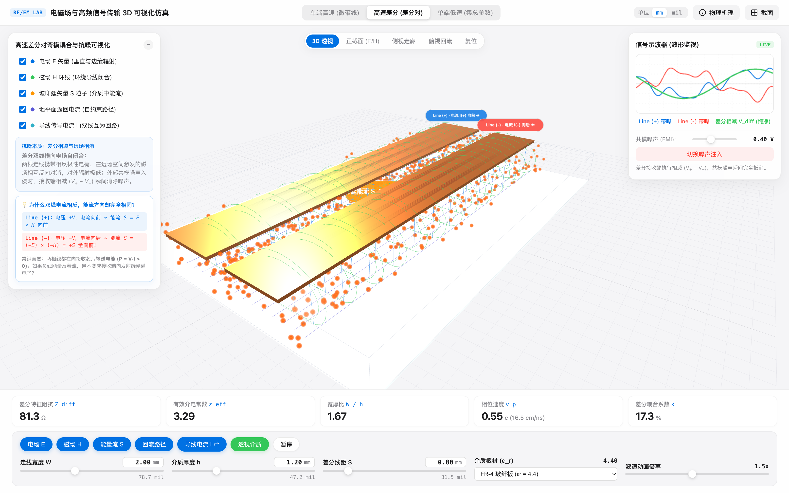
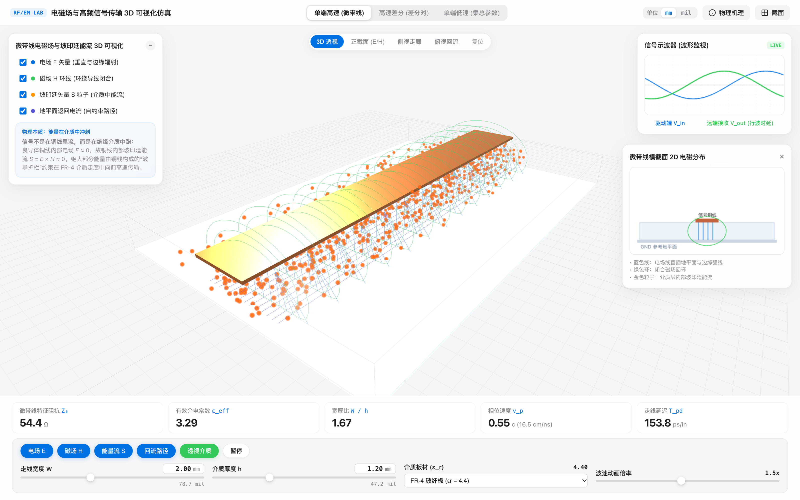
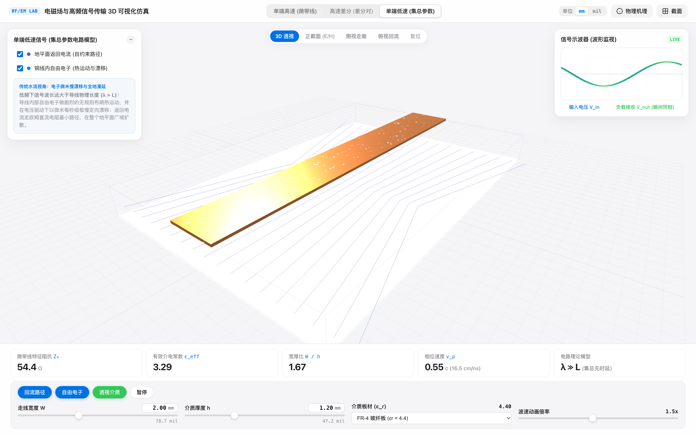
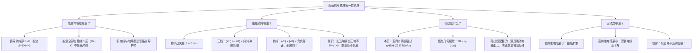

# 高频电磁信号与波传播深度物理指南
## ——从麦克斯韦方程、坡印廷能流、空间右手定则到底层特征阻抗

> **项目配套在线 3D 仿真实验室**：[https://bohemianer.github.io/Poynting/](https://bohemianer.github.io/Poynting/)  
> **GitHub 开源仓库**：[https://github.com/bohemianer/Poynting](https://github.com/bohemianer/Poynting)  
> **适用读者**：硬件工程师、PCB Designer、射频/微波研发、系统架构师及电子信息方向学习者。

---

## 目录
1. [引言：打破“水流模型”的常识认知](#一引言打破水流模型的常识认知)
2. [麦克斯韦电磁场与坡印廷定理：能量究竟在哪里流动？](#二麦克斯韦电磁场与坡印廷定理能量究竟在哪里流动)
3. [三维空间右手定则实战：手把手判别 E、H 与 S 的几何流向](#三三维空间右手定则实战手把手判别-eh-与-s-的几何流向)
4. [差分对的物理奇迹：为什么双线电流相反，能流方向却完全相同？](#四差分对的物理奇迹为什么双线电流相反能流方向却完全相同)
5. [特征阻抗的底层奥秘：宏观电路与微观电磁场的终极桥梁](#五特征阻抗的底层奥秘宏观电路与微观电磁场的终极桥梁)
6. [低速电路 vs 高速微带线：物理分界线与地平面回流行为](#六低速电路-vs-高速微带线物理分界线与地平面回流行为)
7. [总结与第一性原理思维脑图](#七总结与第一性原理思维脑图)

---

## 一、引言：打破“水流模型”的常识认知

从初中到大学低年级，所有的电路教学几乎都在灌输同一个比喻：
> *“电池是水泵，导线是水管，开关是阀门，电流就像水流一样在铜线里咕嘟咕嘟往前淌。”*

这个“水流假说”在直流或低频（几十 Hz 到几 kHz）下非常实用，它帮我们建立了欧姆定律（$V=IR$）和基尔霍夫定律（KCL/KVL）的直觉。

**但在高频与现代高速数字系统（几百 MHz 到数十 GHz）中，这个比喻彻底破产了。**

如果你继续坚信“信号在铜线内部跑”，你就永远无法理解以下工程现象：
* 为什么微带线阻抗必须严格控制在 $50\,\Omega$？明明铜线的直流电阻只有 $0.02\,\Omega$。
* 为什么芯片之间没有导线相连的两个相邻信号线会有可怕的串扰（Crosstalk）？
* 为什么一段短短几厘米开路的 PCB 走线会产生 $2$ 倍过冲的剧烈振铃？
* 为什么在高速差分信号中，正线电流向前、负线电流向后，两根线传输的电磁能量却全都在以近半光速向前狂飙？

**现代高速信号的真实物理图景是：信号根本进不去铜导线内部，绝大部分能量都在铜导线外面的绝缘板材（介质层）中以电磁波的形式光速冲刺！铜导线与地平面，仅仅是约束电磁能量不扩散的“波导护栏”。**

---

## 二、麦克斯韦电磁场与坡印廷定理：能量究竟在哪里流动？

### 1. 良导体内部的“电场屏蔽”与趋肤效应
铜是一种良导体（电导率 $\sigma \approx 5.8 \times 10^7\,\text{S/m}$）。在良导体内部，自由电子浓度极高（约为 $10^{28}\,\text{m}^{-3}$）。
当外界高频电磁场试图进入铜线时，内部的自由电子会在飞秒级时间内自发重排，在导体内部建立一个与外场大小相等、方向相反的感应场，瞬间抵消内部的电场：
$$\mathbf{E}_{\text{conductor}} \approx 0$$

即使考虑交流趋肤深度 $\delta = \sqrt{\frac{1}{\pi f \mu \sigma}}$，在 $1\,\text{GHz}$ 下，铜的趋肤深度仅为 $2.06\,\mu\text{m}$，绝大部分铜线芯部是完全没有交变电磁场穿透的。

### 2. 坡印廷定理（Poynting's Theorem）
根据经典电动力学麦克斯韦方程组推导，空间中电磁能量的流动密度由**坡印廷矢量（Poynting Vector）**严格定义：
$$\mathbf{S} = \mathbf{E} \times \mathbf{H} \quad \left[\text{单位：}\text{W/m}^2\right]$$
* $\mathbf{E}$：电场强度矢量（$\text{V/m}$）
* $\mathbf{H}$：磁场强度矢量（$\text{A/m}$）
* $\mathbf{S}$：空间中单位时间穿过单位面积的能量流矢量（方向即为电磁能量前行方向）

**致命一问：铜导线内部的能流是多少？**
因为铜导线内部 $\mathbf{E} \approx 0$，直接代入坡印廷公式：
$$\mathbf{S}_{\text{inside copper}} = \mathbf{E} \times \mathbf{H} \approx 0 \times \mathbf{H} \approx 0$$
**结论震惊物理界：铜导线内部根本没有能量在流动！**

### 3. 能量究竟跑在哪儿？
真正充满电场 $\mathbf{E}$ 和磁场 $\mathbf{H}$ 的地方，是铜导线与下方地平面之间夹着的**绝缘介质板材（FR-4 玻纤板或聚四氟乙烯）**以及上方的空气层！
在介质中：
* 电场 $\mathbf{E} \neq 0$（走线与地平面之间存在高频电压差）；
* 磁场 $\mathbf{H} \neq 0$（走线表层高频电流环绕激发空间磁场）；
* 因此 $\mathbf{S} = \mathbf{E} \times \mathbf{H} \gg 0$！

*(图 1：单端高速微带线 3D 仿真。金色光子状粒子代表介质中狂飙的坡印廷能流 $\mathbf{S}$，蓝色垂直线为直插地平面的电场 $\mathbf{E}$，绿色闭合圆环为磁场 $\mathbf{H}$，铜走线仅作为波导边界)*

---

## 三、三维空间右手定则实战：手把手判别 E、H 与 S 的几何流向

为什么在单端微带线中，坡印廷能流一定是朝着正前方的接收芯片推进的？让我们用三维空间右手定则一步步推演。

### 1. 建立空间观测坐标系
设想你作为观察者，站在 PCB 发送端（驱动芯片）的正后方，面向接收端（接收芯片）望去：
* **前后方向（$z$ 轴）**：正前方去往接收端（$+z$），正后方流回驱动源（$-z$）；
* **上下方向（$y$ 轴）**：上方是铜走线（$+y$），下方是垫在底部的地平面 GND（$-y$）；
* **左右方向（$x$ 轴）**：你的左侧为 $-x$，右侧为 $+x$。
* **介质层**：夹在上下走线与地平面之间的空间。

### 2. 第一步：判断电场 $\mathbf{E}$ 的方向（垂直向下）
* 此时驱动器输出正电平（比如 $+1.2\,\text{V}$），铜走线聚集正电荷；底部的参考地为 $0\,\text{V}$。
* 物理定律规定：**电场线从高电位指向低电位**。
* 在走线正下方的绝缘介质中，电场线像水帘一样垂直指向下方地平面：
  $$\mathbf{E} \text{ 方向：}\mathbf{-y} \text{（垂直向下）}$$

### 3. 第二步：判断磁场 $\mathbf{H}$ 的方向（水平向右）
* 正向信号电流正沿着走线向正前方的负载奔跑（电流方向为 $+z$）。
* 拿出初中学的**安培右手螺旋定则**：
  * 右手大拇指指向电流行进方向（**正前方 $+z$**）；
  * 四指自然握拳，四指环绕走线的方向就是磁力线闭合的方向（顺时针绕导线闭合）；
* 聚焦在走线正下方的绝缘介质层：
  * 磁力线顺时针从走线上方绕过、从右侧往下沉、在走线正下方**从左侧水平横扫向右侧**！
  $$\mathbf{H} \text{ 方向：}\mathbf{+x} \text{（水平向右）}$$

### 4. 第三步：右手叉乘定则计算能流 $\mathbf{S} = \mathbf{E} \times \mathbf{H}$
数学向量叉乘法则遵循右手螺旋：
1. **伸出右手，四指完全展开**；
2. **四指顺着第一个矢量 $\mathbf{E}$ 的方向**：手掌朝下，四指**垂直指向地面（向下）**；
3. **四指向第二个矢量 $\mathbf{H}$ 弯曲握拳**：因为磁场 $\mathbf{H}$ 在右侧，所以四指从下方**朝身体右侧握拳合拢**；
4. **翘起大拇指**：你发现大拇指朝向哪里？
   * 它只能笔直地、毫无争议地指向——**你的正前方（$+z$）！**

$$\mathbf{S} = (\text{向下 } -\hat{y}) \times (\text{向右 } +\hat{x}) = \text{正前方 } +\hat{z}$$

**这就是麦克斯韦方程的几何铁律：电磁波能量被牢牢校准在绝缘介质通道中，以接近光速向前喷射，直达接收端！**

### 5. 全空间 $360^\circ$ 各位置自洽性验证
无论在走线周围的哪个微元，叉乘结果全部指向前方：
* **走线上方空气层**：电场向上（$+\hat{y}$），磁场向左（$-\hat{x}$），$(+\hat{y}) \times (-\hat{x}) = +\hat{z}$（**向前**）；
* **走线右侧边缘区**：电场向右下发散，磁场向下弯折，叉乘依然指向 $+\hat{z}$（**向前**）。
整根微带线周围的空间介质就像一个各处同步向前喷气的无形波导管！

---

## 四、差分对的物理奇迹：为什么双线电流相反，能流方向却完全相同？

这是整个高速电路中最令人拍案叫绝的“反常识”设计：
在高速差分对（如 USB、PCIe、SATA、以太网）中，两根线分别走互补信号：
* $\text{Line(+)}$：电平 $+V$，传导电流**向前奔跑（$+z$）**；
* $\text{Line(-)}$：电平 $-V$，传导电流**向后流回（$-z$）**。

很多工程师纳闷：“两根线的电流明明一前一后相反，为什么在 3D 动画中，两根线周围的金色能量粒子全部都在朝着前方同一个方向狂奔？”

*(图 2：高速差分对 3D 仿真。左侧 Line(+) 导线表面电流向前，右侧 Line(-) 导线表面电流向后；但中间介质层所有金色能流光子在两根线周围全部一致向前输送)*

### 1. 负负得正：数学向量的必然自洽
让我们用坡印廷公式严格计算负线 $\text{Line(-)}$ 的能流 $\mathbf{S}_-$：
* **电场反向了（$-\mathbf{E}$）**：负线电位是 $-1.2\,\text{V}$，底部的地是 $0\,\text{V}$（地比走线电位高！）。电场线从高电位（地）指向低电位（走线），所以在负线下方，**电场方向颠倒为垂直向上（$+\hat{y}$）**；
* **磁场也反向了（$-\mathbf{H}$）**：负线的传导电流是反向流回驱动端的（电流方向为 $-\hat{z}$）。右手大拇指朝后，四指弯曲在导线下方变为**从右向左横扫（$-\hat{x}$）**；
* **代入叉乘公式**：
  $$\mathbf{S}_- = (-\mathbf{E}) \times (-\mathbf{H}) = (-1) \cdot (-1) \cdot (\mathbf{E} \times \mathbf{H}) = +\mathbf{S}$$
  **两个负号相乘，负负得正！右手四指指向上方，向左握拳，大拇指依然笔直指向正前方（$+\hat{z}$）！**

### 2. 热力学与常识常理的终极检验
用输出功率公式思考：
* 驱动器在正线上输出功率：$P_+ = (+V) \times (+I) = +P > 0$（正能量送出）；
* 驱动器在负线上输出功率：$P_- = (-V) \times (-I) = +P > 0$（同样是正能量送出！）。

**发送芯片是在给接收芯片“供电与传递信息”，两根线都是输出正功率。如果负线的电磁能量是反着跑的，那就意味着“负线在把能量从接收芯片倒灌回发射芯片”，这在热力学和能量守恒定律上是绝对不允许发生的荒谬现象！**

### 3. 差分对奇模耦合与远场相消
为什么要把差分双线紧挨着布线？
* **横向电场自闭合（奇模）**：正线带正电荷，负线带负电荷，两根线之间产生了强大的横向吸引电场。大部分电场线直接在两线之间闭合，不再散溢到外壳，辐射极小；
* **外部磁场相互抵消**：正线激发的顺时针磁场与负线激发的逆时针磁场在远场空间幅度相等、方向相反，**在空间中自抵消为零**（近乎零 EMI 辐射）；
* **接收端相减彻底消除共模噪声**：若外界有强电磁干扰侵入，两根线同时被感应叠加等量同相噪声 $V_{\text{noise}}$：
  $$V_{\text{diff}} = (V_+ + V_{\text{noise}}) - (V_- + V_{\text{noise}}) = V_+ - V_-$$
  共模干扰瞬间被差分运放减法器归零！

---

## 五、特征阻抗的底层奥秘：宏观电路与微观电磁场的终极桥梁

为什么射频与高速板必须做 $50\,\Omega$（单端）或 $100\,\Omega$（差分）阻抗控制？
拿万用表去量微带线，铜线电阻是 $0\,\Omega$；量走线与地之间，电阻是 $\infty$。这 $50\,\Omega$ 究竟从何而来？

### 1. 介质波阻抗（Wave Impedance $\eta$）
在麦克斯韦电磁世界中，光波（电磁波）在任何非导电空间前行时，其瞬时电场强度 $E$ 与瞬时磁场强度 $H$ 的比值不是随意的，而是被物理介质常数锁定的刚性比例：
$$\eta_0 = \frac{|\mathbf{E}|}{|\mathbf{H}|} = \sqrt{\frac{\mu_0}{\varepsilon_0}} \approx 376.73\,\Omega \approx 377\,\Omega \quad (\text{真空波阻抗})$$
在常用的 FR-4 环氧树脂板材中（相对介电常数 $\varepsilon_r \approx 4.4$）：
$$\eta = \sqrt{\frac{\mu_0}{\varepsilon_r \varepsilon_0}} = \frac{377\,\Omega}{\sqrt{4.4}} \approx 180\,\Omega$$
**这意味着：在 FR-4 介质中，电磁能量波每建立 $180\,\text{V/m}$ 的电场，就必须刚性伴生 $1\,\text{A/m}$ 的磁场，多一点不行，少一点也不行！**

### 2. 从电磁场积分到宏观特征阻抗
我们电路中测量的电压 $V$ 和电流 $I$，本质是电场和磁场在线路截面上的几何积分：
* **电压 $V$**：电场沿介质厚度 $h$ 从走线直插地平面的线积分：
  $$V = \int_0^h \mathbf{E} \cdot d\mathbf{l} \approx E \cdot h$$
* **电流 $I$**：磁场沿走线周长 $w$ 环绕一周的回路积分（安培环路定律）：
  $$I = \oint \mathbf{H} \cdot d\mathbf{l} \approx H \cdot w$$

把宏观电压除以电流：
$$Z_0 = \frac{V}{I} = \frac{E \cdot h}{H \cdot w} = \left(\frac{E}{H}\right) \cdot \left(\frac{h}{w}\right) = \eta \cdot \frac{h}{w}$$

**特征阻抗 $Z_0$ 的本质，就是介质材料本征波阻抗 $\eta$ 乘以 PCB 几何板厚走线宽比（$h/w$）！**

*(图 3：2D 横截面场分布与阻抗计算。通过 IPC-2141/Wheeler 公式精确计入边缘效应与有效介电常数 $\varepsilon_{\text{eff}}$)*

### 3. Wheeler 工业精确微带线方程（IPC-2141 标准）
实际微带线由于电场部分暴露在空气中（$\varepsilon_{\text{air}}=1$）、部分在板材中（$\varepsilon_r$），需要计算**有效介电常数 $\varepsilon_{\text{eff}}$**：
$$\varepsilon_{\text{eff}} = \frac{\varepsilon_r + 1}{2} + \frac{\varepsilon_r - 1}{2} \cdot \left(1 + \frac{12}{w/h}\right)^{-0.5}$$
特征阻抗 $Z_0$（当 $w/h \ge 1$ 时）：
$$Z_0 = \frac{120\pi}{\sqrt{\varepsilon_{\text{eff}}} \cdot \left[\frac{w}{h} + 1.393 + 0.667 \ln\left(\frac{w}{h} + 1.444\right)\right]}$$

### 4. 阻抗匹配第一性原理：为什么不匹配就会反弹？
坡印廷能流 $\mathbf{S}$ 以每秒 15 万公里（近半光速）在绝缘介质通道中往前狂奔。这一路行波所携带的电场能量和磁场能量比例，已经被传输线的几何特征阻抗 $Z_0 = 50\,\Omega$ 严格锁定了。

当行波猛冲到终端接收芯片（负载电阻 $R_L$）时：
* **完美匹配（$R_L = Z_0 = 50\,\Omega$）**：  
  接收芯片对电压与电流的比值需求恰好是 $50\,\Omega$。冲过来的电场与磁场能量被芯片**$100\%$ 无损吸收**，转变为门极开关信号。反射系数 $\Gamma = \frac{R_L - Z_0}{R_L + Z_0} = 0$，波形干净稳定；
* **开路不匹配（$R_L = \infty$）**：  
  接收端输入阻抗极高（CMOS 输入门极电阻达兆欧级，只要电压不要电流 $I=0$）。但是冲过来的电磁波里带着庞大的磁场能量（伴生高频电流）！负载无法吸收磁场能量，**根据能量守恒定律，能量绝不会凭空湮灭，只能全额掉头反射！**  
  反射波反向倒灌（能流 $\mathbf{S}_{\text{refl}}$ 向后流），与正向波相撞同相叠加，电压瞬间翻倍（$2\text{倍}$ 恶性过冲），并在发送端和接收端之间反复反弹，形成示波器上典型的**衰减振铃（Ringing）**，极易误触发逻辑芯片！
* **短路不匹配（$R_L = 0$）**：  
  接收端直接接地（只要电流不要电压 $V=0$）。电场能量无法被吸收，反相全额反射，把波形拉垮到地。

**结论：做阻抗匹配，绝不是为了省电，而是为了让光速奔跑的电磁波能量在撞击芯片时不发生“回音壁反弹”！**

---

## 六、低速电路 vs 高速微带线：物理分界线与地平面回流行为

什么时候我们必须把导线看成传输线，什么时候可以用传统集总电路分析？

*(图 4：低速集总参数模型 3D 仿真。铜线内自由电子做微米/秒极慢热运动漂移，地平面返回电流按直流电阻最小路径在整张板上广域漫延)*

### 1. 物理分界判据：上升时间与波长准则
决定信号是“高速”还是“低速”的，**不是时钟频率本身，而是信号脉冲的上升时间 $t_r$（Rise Time）与导线物理长度 $L$ 的相对关系**！

信号在介质中的传播速度：
$$v = \frac{c}{\sqrt{\varepsilon_{\text{eff}}}} \approx 1.5 \times 10^8\,\text{m/s} = 15\,\text{cm/ns}$$
信号在上升时间内在板子上行进的空间距离（有效波长前沿）：
$$l_{\text{rise}} = v \times t_r$$

* **集总参数电路条件（低速）**：$L \ll \frac{l_{\text{rise}}}{6}$  
  若走线物理长度远小于信号跳变前沿跨越的空间长度，整根导线在任一瞬间的电位近乎处处相等，可以忽略空间波动效应，采用传统欧姆定律分析；
* **分布参数传输线条件（高速）**：$L \ge \frac{l_{\text{rise}}}{6}$  
  若走线长度达到或超过前沿跨越距离的 $1/6$（例如 $t_r = 1\,\text{ns}$，临界长度仅为 $2.5\,\text{cm}$！），当信号波前刚到达导线中段时，驱动端可能已经跳变结束，导线沿线不同位置的电压各不相同，**必须作为麦克斯韦电磁波波导处理**。

### 2. 地平面返回电流（Return Current）路径的根本跃迁
地平面上的回流电流永远走“复阻抗最小路径”（$\min |Z| = \min \sqrt{R^2 + (\omega L)^2}$）：

| 信号物理状态 | 主导阻抗物理量 | 回流在接地平面的实际路径分布 | 危害与工程启示 |
| :--- | :--- | :--- | :--- |
| **低速信号（低频）** | **欧姆电阻 $R$** 主导 | 走源端到负载之间欧姆电阻最小的直线，**在整个地平面广域扩散漫延**。 | 会与板上其他模拟低频电路共享阻抗，引发共地耦合噪声。 |
| **高速信号（高频）** | **回路电感 $L$** 主导（$j\omega L \gg R$） | 为使信号线与回流构成的回路面积最小、磁通最小、电感最小，**回流紧紧聚拢锁定在信号走线的正下方**！ | **严禁在高速走线下方破坏地平面（跨分割）**！一旦地平面被切开裂缝，回流被迫绕道，回路面积暴增，电感飙升，对外瞬间激起剧烈辐射与 EMI 恶梦！ |

---

## 七、总结与第一性原理思维脑图

---

### 📚 参考与推荐扩展阅读
1. **Howard Johnson & Martin Graham** - *High-Speed Digital Design: A Handbook of Black Magic*（高速电路设计的传世经典）
2. **Eric Bogatin** - *Signal and Power Integrity - Simplified*（信号完整性分析与直觉第一书）
3. **John D. Kraus** - *Electromagnetics with Applications*（麦克斯韦与坡印廷电动力学）
4. **Ralph Morrison** - *Fast Circuit Boards: Energy Management*（从纯能量与空间电磁场视角剖析 PCB 走线）
